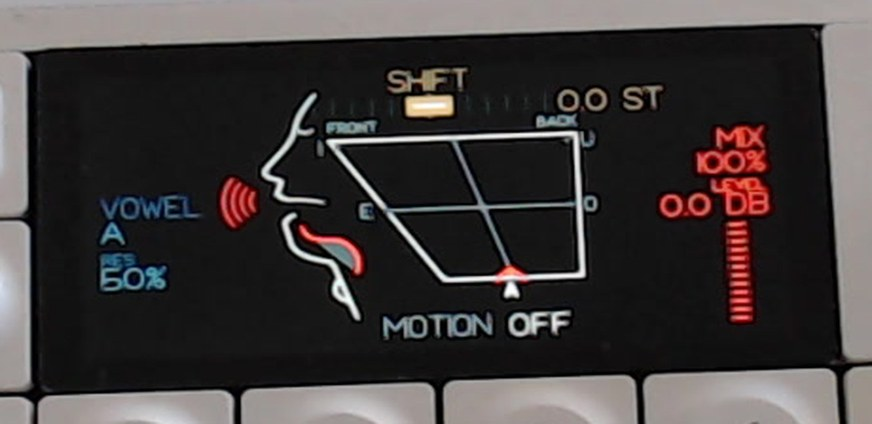

# vowel

An [open-field](https://github.com/LaP0573/open-field) pack for the OP-1 Field on OS 1.7.3: **a vowel filter in the unit's list of effects, with three formants that move between a, e, i, o and u.**



*A webcam photo of the unit's screen: vowel's page with VOWEL at `a`, SHIFT at 0.0 st, MOTION off and MIX at 100 %.*

vowel is a formant filter: three band-pass filters a side sit on the formants of a sung vowel, so a sound put through it seems to say a, e, i, o or u. It is an effect of the unit's own kind: you pick it from the effect list of a synth sound, a drum sound or the master, and open-field's fx train offers it on its wagons. Four knobs set the vowel, shift all formants up or down, add motion (from how loud you play, or a sweep in time with the tempo) and mix dry to wet. Its page is drawn: a head in profile whose tongue, lips and jaw take the vowel, and a vowel chart with a red point for the tongue. The pack changes no place of the firmware.

## Listen

| Recording | What it shows |
| --- | --- |
| [a, e, i, o, u and back](media/vowel-01-a-e-i-o-u-and-back.mp3) | One chord held while the VOWEL knob goes from a to u, then a second chord on the way back. MOTION off, MIX 100 % |
| [SHIFT down and up](media/vowel-02-shift-down-and-up.mp3) | Vowel a on one chord. SHIFT goes from 0 down to -12 st, up to +12 st and back to 0 |
| [A bass line with envelope motion](media/vowel-03-bass-line-with-envelope-motion.mp3) | A bass line with MOTION on env 100 % |
| [Chords with motion in time](media/vowel-04-chords-with-motion-in-time.mp3) | Four chords twice: MOTION on 1/4, then on 1/8, at tempo 100 |

Played over MIDI by a script and recorded from the unit's own USB audio; only the level was changed. They also play in the browser on [the packs page](https://hooligan333.github.io/open-field-packs/#vowel).

## Use

1. On a synth or drum sound, hold **shift**, press **T3** (the third of the four keys under the screen) and pick `vowel` from the list. For the master, press the mixer key, open the master effect's list and pick `vowel` there.
2. Play. A new vowel starts on `u`, mostly wet, with the envelope moving it.
3. Press **T3** to see its page. T3 again switches vowel off or on.

| Knob | What it does |
| --- | --- |
| Blue | VOWEL: a, e, i, o, u and everything between (`o+u 25%`) |
| Ochre | SHIFT: all formants up or down together, an octave each way, in semitones |
| Grey | MOTION. Middle: off. Left: louder playing opens the mouth towards a. Right: a sweep locked to the tempo, in 1/1, 1/2, 1/4, 1/8 or 1/16 notes |
| Red | MIX: dry to wet |
| Shift + blue | RES: how narrow the formants are (50 % is the table's own width) |
| Shift + red | LEVEL: the loudness of the wet sound, -12 to +12 dB |

The full guide is [docs/vowel.md](docs/vowel.md).

## Status

Tried on a unit on 2026-11-25: OS 1.7.3, open-field 0.19 (base 37); it also starts on open-field 0.21 (base 39). The tests were run by remote control over USB: keys and knobs sent as MIDI, the unit's log, its USB audio, and a webcam on the screen.

What that showed:

- The pack starts, its picture is made on the unit, and the start leaves no trouble line in the log.
- The page is drawn and moves: head, tongue and jaw follow the vowel, the red point moves over the chart, `off` shows while vowel is switched off and goes away again, and the signs `+ . % / -` in the values are all drawn.
- The sound follows the VOWEL knob: the strong band moves from 400-900 Hz at `a` to 250-400 Hz at `u`.
- Its heaviest call ran over the processor time the pack declares (see Limits). open-field did not switch it off.

Not covered by that round: vowel on a drum sound, on the master and on fx train; an LFO on its values; turning RES and LEVEL; saving a sound with vowel and loading it back; a saved sound on a unit without the pack. The sound was measured, not judged by ear.

## Install

Tick it on open-field's install page once it is listed there, or copy `vowel.pack` into the unit's `packs` folder in disk mode and restart.

If the unit does not start with it, hold the **help** key while switching on: it then starts with no packs, and you can delete the file in disk mode.

It needs open-field 0.12 or later (base 30 or later) and no other pack. There is no folder and no other file to copy: the picture of its page is made on the unit at the start.

## Limits

- With the unit's USB audio streaming to a computer, its heaviest call took 71,766 processor cycles against the 40,000 it declares. It was not switched off. If open-field does switch it off for its cost, the page says `switched off`.
- Drums and noise come out quieter wet than dry: a formant filter keeps three narrow bands. LEVEL is there for them. Above +6 dB of LEVEL a loud chord saturates.
- On fx train the wagon is drawn as the unit's `cwo` with the name `vowel`, and RES and LEVEL stay at the middle.
- No LFO moves RES and LEVEL.
- RES and LEVEL are kept with the sound. Pick another effect and then vowel again on the same sound: the four knobs start over, but RES and LEVEL stay where you left them.
- vowel stands on the unit's `cwo` effect. A sound saved with vowel keeps cwo's name and the four knob values, switched off; on a unit without the pack it should play dry (not tried).
- The tempo sweep runs at the tempo's rate but is not started on the beat.
- On the page a long VOWEL text (`o+u 50%`) reaches the red sound lines beside the mouth.

## Files

| File | What |
| --- | --- |
| `vowel.pack` | The pack, version 5: 31,429 bytes, SHA-256 `d659342a3ea61f129fa47d4d150bcb74c356f4b2945ec25515453b73e7923f7d` |
| `source/recipe.json` | Its name, version and sources, and the effect's four values |
| `source/vowel.cpp` | The pack: the effect's block function, RES and LEVEL on shift, the page |
| `source/vowel_core.h` | The sound: the formant table and the filters, in whole-number arithmetic |
| `source/vowel-face.svg.make` | The picture of the page, in the form the unit makes it from at the start |
| `source/vowel_card.s`, `source/vowel_pictures.s` | Made from `recipe.json` by open-field's `tools/pack_build.py`: the pack's card and its list of pictures |
| `docs/vowel.md` | The full guide |
| `media/` | Two photos of the unit's screen and the four recordings |
| `LICENSE` | MIT |

## Build

Copy `source/` into an open-field tree as `examples/vowel/`, then:

```bash
python -I tools/pack_build.py build3 --recipe examples/vowel/recipe.json --profile profiles/op1f-1.7.3.json --out out/vowel.pack
```

Built this way against open-field 0.21, it comes out byte for byte as the file here.

## Sources and thanks

The formant frequencies, levels and bandwidths are the tenor values of the Csound manual, appendix "Formant Values" (the first three of its five formants). vowel runs on [open-field](https://github.com/LaP0573/open-field): its base pack, its effect interface and its build tools.

Unofficial; not made, endorsed or supported by Teenage Engineering. MIT licence.
