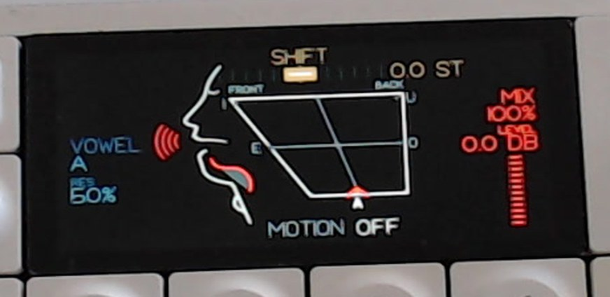
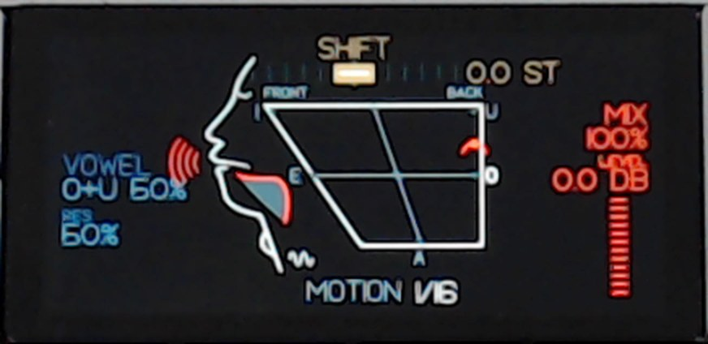

# vowel: the guide

vowel is a formant filter for the OP-1 Field: it makes any sound say a, e, i, o, u. It is an [open-field](https://github.com/LaP0573/open-field) pack and an effect of the unit's own kind, in the unit's lists of effects.

This guide is for `vowel.pack` version 5 (31,429 bytes, SHA-256 `d659342a3ea61f129fa47d4d150bcb74c356f4b2945ec25515453b73e7923f7d`). It needs OS 1.7.3 with open-field 0.12 or later (base 30 or later). It changes no place of the firmware, names no address of it and needs no other pack.



*A webcam photo of the unit's screen: VOWEL at `a`, SHIFT at 0.0 st, MOTION off, MIX at 100 %.*

## Where to find it

- **On a synth or drum sound**: hold shift and press T3 (the third of the four keys under the screen), and pick `vowel`. The list is sorted by name: `vowel` comes after `vocoder` where that is listed, and a pack effect whose name sorts later comes after it. Play. Press T3 to see its page; T3 again switches it off or on.
- **On the master**: press the mixer key (the fourth of the mode keys synth, drum, tape, mixer), open the master effect's list and pick `vowel`.
- **On fx train**: it is offered on every wagon. See "On fx train" below.

## The knobs

| Knob | What |
| --- | --- |
| Blue | VOWEL: a, e, i, o, u and everything between (`o+u 25%`) |
| Ochre | SHIFT: all formants up or down together, an octave each way (in semitones) |
| Grey | MOTION. Middle: off. Left: louder playing opens the mouth towards "a". Right: a sweep locked to the tempo, 1/1, 1/2, 1/4, 1/8 or 1/16 notes |
| Red | MIX: dry to wet |
| Shift + blue | RES: how narrow the formants are (50 % is the table's own) |
| Shift + red | LEVEL: the wet's loudness, -12 to +12 dB |
| T3 | Switches vowel off and on |

A new vowel starts on `u`, with MOTION on the envelope at about 60 %, MIX mostly wet (79 %), RES at 50 % and LEVEL at 0.0 dB.

More on each:

- **VOWEL** is a position along a, e, i, o, u. Between two vowels the three formants move smoothly from the one to the other. The text names the nearest letter, then the other neighbour and its share: `o+u 25%`.
- **SHIFT** moves all three formants together, from an octave down (`-12.0 st`) to an octave up (`+12.0 st`). The formants stay between 100 Hz and 7,000 Hz.
- **MOTION, left of the middle** (`env 1%` to `env 100%`): the louder the sound that comes in, the more the formants are pulled from the knob's vowel towards "a". The envelope rises fast and falls with a time constant of about 120 ms.
- **MOTION, right of the middle**: the vowel sweeps around the knob's vowel, up to half the way from a to u on each side, and turns back at the ends. The five zones are a sweep every whole, half, quarter, eighth or sixteenth note of the tempo: a 1/4 sweep takes one beat. The tempo is the one open-field hands every effect. The sweep keeps the tempo's rate, but it is not started on the beat.
- **MOTION, middle**: off. The middle is a narrow zone.
- **MIX** at 0 % passes the sound unchanged.
- **RES** at 50 % gives the bandwidths of the formant table. At 0 % they are four times wider; at 100 % about a third as wide (narrower, more vocal).
- **LEVEL** changes the wet sound only.

## The page

T3 shows vowel's page: a head in profile and a vowel chart.

- **VOWEL** shapes the tongue, the lips and the jaw (the lips are open at a, spread at e and i, round at o and u), lights the nearest letter on the chart and moves a red tongue point over it. Its value is at the left, under VOWEL.
- **SHIFT** is a slider at the top. Shifted up, the head gets smaller and the larynx rises along the neck; shifted down, the head gets bigger and the larynx sinks.
- **MOTION** is at the bottom. One to three breath puffs at the throat stand for the envelope, a small wave for the sweep; the wave gets narrower from 1/1 to 1/16.
- **MIX** fills a red ladder on the right and sends up to four red sound lines out of the mouth. At 0 % there are none.
- **RES** (left) and **LEVEL** (right) are always shown; shift + blue and shift + red turn them.

The unit writes in capitals, so the page reads `O+U 50%` where this guide writes `o+u 50%`.



*A webcam photo of the unit's screen: VOWEL half-way between o and u, MOTION a sweep in 1/16 notes (the small wave at the throat), MIX at 100 %.*

The page shows the four values as the sound plays them, not as the knobs stand, so a move by an LFO should show on it (not tried on a unit).

While vowel is switched off, `off` shows at the top left and the head goes dim.

If open-field had to switch vowel off for its cost, or had no room for it, open-field shows its own plain page instead, with `switched off` or `no room` under the name and without the values.

If the picture of the page cannot be made on the unit, vowel writes its values as plain text on open-field's blank page: four columns in the knobs' colours, with RES and LEVEL in the first and fourth column while shift is held.

## The sound

Each side of the stereo sound goes through three band-pass filters in parallel, one for each formant (state-variable filters of the Chamberlin form). The third formant enters with the opposite sign, so that the skirts between the second and the third add up instead of cancelling. The three are summed, pass a soft saturator (it bends above three quarters of full scale) and are mixed with the dry sound.

The formants are those of a tenor voice:

| Vowel | F1: Hz / dB / bandwidth Hz | F2 | F3 |
| --- | --- | --- | --- |
| a | 650 / 0 / 80 | 1080 / -6 / 90 | 2650 / -7 / 120 |
| e | 400 / 0 / 70 | 1700 / -14 / 80 | 2600 / -12 / 100 |
| i | 290 / 0 / 40 | 1870 / -15 / 90 | 2800 / -18 / 100 |
| o | 400 / 0 / 40 | 800 / -10 / 80 | 2600 / -12 / 100 |
| u | 350 / 0 / 40 | 600 / -20 / 60 | 2700 / -17 / 100 |

The filters' settings are worked out once for each block of 64 samples, smoothed, and moved across the block in eight steps, so a turn of a knob makes no step in the sound. All of it is whole-number arithmetic: no floating point, no division by a variable, no 64-bit number.

**How loud the wet sound is.** The wet's gain is fixed: +12 dB of make-up, a small trim for each vowel, and LEVEL. Nothing in it follows the signal. The trim is set so that a chord of sawtooth waves comes out about as loud wet as dry. Other material does not: a formant filter keeps three narrow bands, and what a sound has outside them is lost. Worked out on a computer with the pack's own sound code (LEVEL at 0.0 dB, MIX full, MOTION off), wet against dry in dB:

| Material | a | e | i | o | u |
| --- | --- | --- | --- | --- | --- |
| Sawtooth chord (minor seventh) from 110 Hz | -2.4 | -1.8 | -2.7 | -0.7 | -2.0 |
| Sawtooth chord from 220 Hz | +1.2 | +2.2 | +1.3 | +3.4 | +1.9 |
| Sawtooth chord from 440 Hz | +4.8 | -1.0 | -9.9 | -1.6 | -7.1 |
| White noise | -8.3 | -13.4 | -13.7 | -12.8 | -13.5 |
| Pink noise | -3.6 | -5.4 | -4.3 | -5.0 | -5.3 |
| A kick (a sine from 170 to 50 Hz) | -20.6 | -16.7 | -12.3 | -18.0 | -16.1 |

So drums and noise come out quieter wet, and a high chord loses the vowels whose first formant lies under its lowest note (i and u). LEVEL is there for that. Above +6 dB of LEVEL a loud chord saturates.

## Kept with the sound

The four knob values are the effect's own: the unit saves them with the sound, or with the master, as it does for its own effects.

RES and LEVEL are the pack's. It keeps them as a value named `vowel_layer` with each synth sound, each drum sound and the master, for example `{"level":16384,"res":16384,"version":1}` (16384 is the middle: RES 50 %, LEVEL 0.0 dB).

The first time vowel is picked on a sound, RES and LEVEL are at their middles. Pick another effect and then vowel again on the same sound, and the four knobs start over, but RES and LEVEL stay where you last left them.

Saving a sound with vowel and loading it back has not been tried on a unit.

## LFOs

The unit's LFOs should move VOWEL, SHIFT, MOTION and MIX, with those names on the LFO pages: that is what open-field gives an effect of this kind. It has not been tried with vowel. No LFO moves RES and LEVEL. The master has no LFO.

## On fx train

open-field's fx train offers vowel on every wagon (on the unit: turn a wagon's knob to the end of its list for a pack's effect, hold the knob to switch the wagon on). As of fx train 17:

- The wagon is drawn as the unit's `cwo` with the name `vowel`: fx train draws every pack's effect as the unit's effect it stands on, and vowel cannot bring a wagon picture of its own.
- RES and LEVEL stay at the middle.
- The train allows 200,000 cycles a block and counts vowel as 40,000: at most four vowels a train, one on each wagon. With `punch` (83,100) and `grid` (53,000) one vowel fits. A second is refused (the wagon flashes); that is not a fault.

vowel on fx train was not part of the unit round of 2026-11-25.

## Without the pack

vowel stands on the unit's `cwo`. A sound saved with vowel keeps cwo's name and four knob values, switched off. On a unit without `vowel.pack`, or on the original firmware, it should play dry. T3 then shows cwo's page, switched off; switching it on plays cwo at vowel's knob positions. Put the pack back and it plays vowel again. None of this has been tried on a unit.

## What was tried on a unit

On 2026-11-25, on a unit with OS 1.7.3 and open-field 0.19 (base 37), by remote control over USB: keys and knobs sent as MIDI, the unit's log, its USB audio, and a webcam on the screen. The same day the unit was moved to open-field 0.21 (base 39): vowel starts there too, its picture made, with no trouble line in the log.

| Check | Result |
| --- | --- |
| The start | The pack runs, its picture is made on the unit, no trouble line |
| The page | Drawn, and it moves: head, tongue and jaw by vowel, the red point on the chart |
| `off` | Shown while switched off, and cleared again |
| The signs in the values (`+ . % / -`) | All drawn |
| The sound | It follows the VOWEL knob: the strong band moves from 400-900 Hz at `a` to 250-400 Hz at `u` |
| Cost | The worst call 71,766 cycles against 40,000 declared; not switched off (see "Cost") |
| The four recordings in `media/` | Made in the same round |

One small thing was seen on the page: a long VOWEL text (`o+u 50%`) reaches the red sound lines beside the mouth.

Not covered by that round: vowel on a drum sound, on the master and on fx train; an LFO on its values; turning RES and LEVEL; saving and loading; a saved sound without the pack. The sound was measured, not judged by ear.

## Cost

| | Cycles in one call (one block of 64 samples) |
| --- | --- |
| Declared to open-field | 40,000 |
| Counted on a computer, the longest path through the code | 28,472 |
| On a unit, 2026-11-23 (version 2), at most | 35,770 |
| On a unit, 2026-11-25 (version 5), at most | 71,766 |

The 40,000 was declared from the figure of 2026-11-23. The figure of 2026-11-25 was taken while the unit's USB audio was streaming to a computer. For the synth engines measured the same day, the large single calls came with that streaming and were much smaller without it; vowel was not measured without it. vowel was not switched off.

While vowel plays, open-field writes a line beginning `effect: 'vowel' this period:` into the unit's log, with the most and the average cycles of a call.

## Lines in the unit's log

Its own lines, tag `vowel`:

```
vowel: its picture vowel-face.svg made
vowel: ready; RES and LEVEL kept as 'vowel_layer' with the sounds and the master
vowel: its page is on the screen for synth 1, switched on; res 16384, level 16384
vowel: its page is no longer on the screen
```

If the first line ends in `NOT made: the values are painted on the blank page`, the plain text page is used.

## Limits

- Its heaviest calls can run over the cost it declares (see "Cost").
- Drums and noise come out quieter wet; a chord from 440 Hz up loses much of i and u.
- Above +6 dB of LEVEL a loud chord saturates.
- On fx train: drawn as `cwo`, RES and LEVEL at the middle.
- No LFO moves RES and LEVEL.
- RES and LEVEL stay with the sound when vowel is picked again on it.
- The tempo sweep is not started on the beat.
- A long VOWEL text reaches the sound lines on the page.

## Install and remove

Only on a unit that runs open-field 0.12 or later (base 30 or later): on an older base the loader leaves the pack out.

Tick it on open-field's install page once it is listed there. Or, by hand: copy `vowel.pack` into the folder `packs` in disk mode, eject, switch off and on.

To remove it, delete `vowel.pack` from `packs`. If the unit does not start properly, hold the **help** key while switching on (no pack is read), then delete it in disk mode.

## Versions

- Earlier, vowel was an effect for fx train only.
- Version 2 was the first in the unit's own lists of effects, with a plain text page. It ran on a unit on 2026-11-23.
- Version 3 brought a drawn page and declared the cost from the unit's figures.
- Version 4 brought the page of this guide, the head and the chart, which follows the sound as it plays.
- Version 5, this one, is version 4 with three lines of the page's code changed. The sound's code is the same.

## The source

| File | What |
| --- | --- |
| `source/vowel_core.h` | The sound: the formant table (made by a generator from the figures above), the filters, the saturator, MOTION |
| `source/vowel.cpp` | The pack around it: the effect's block function, the tempo, RES and LEVEL on shift and their keeping, the page |
| `source/vowel-face.svg.make` | The picture of the page, in the form the unit makes it from at the start |
| `source/recipe.json` | Name, version, sources; the effect's four values and where they start; the declared cost |
| `source/vowel_card.s`, `source/vowel_pictures.s` | Made from `recipe.json` by open-field's `tools/pack_build.py` |

The comments in the sources name some files of the working project (notes, test programs, the table generator) that are not in this repository.

To build, see the README.

## Sources and thanks

The formant frequencies, levels and bandwidths are the tenor values of the Csound manual, appendix "Formant Values" (the first three of its five formants). vowel runs on [open-field](https://github.com/LaP0573/open-field).

Unofficial; not made, endorsed or supported by Teenage Engineering. MIT licence.
